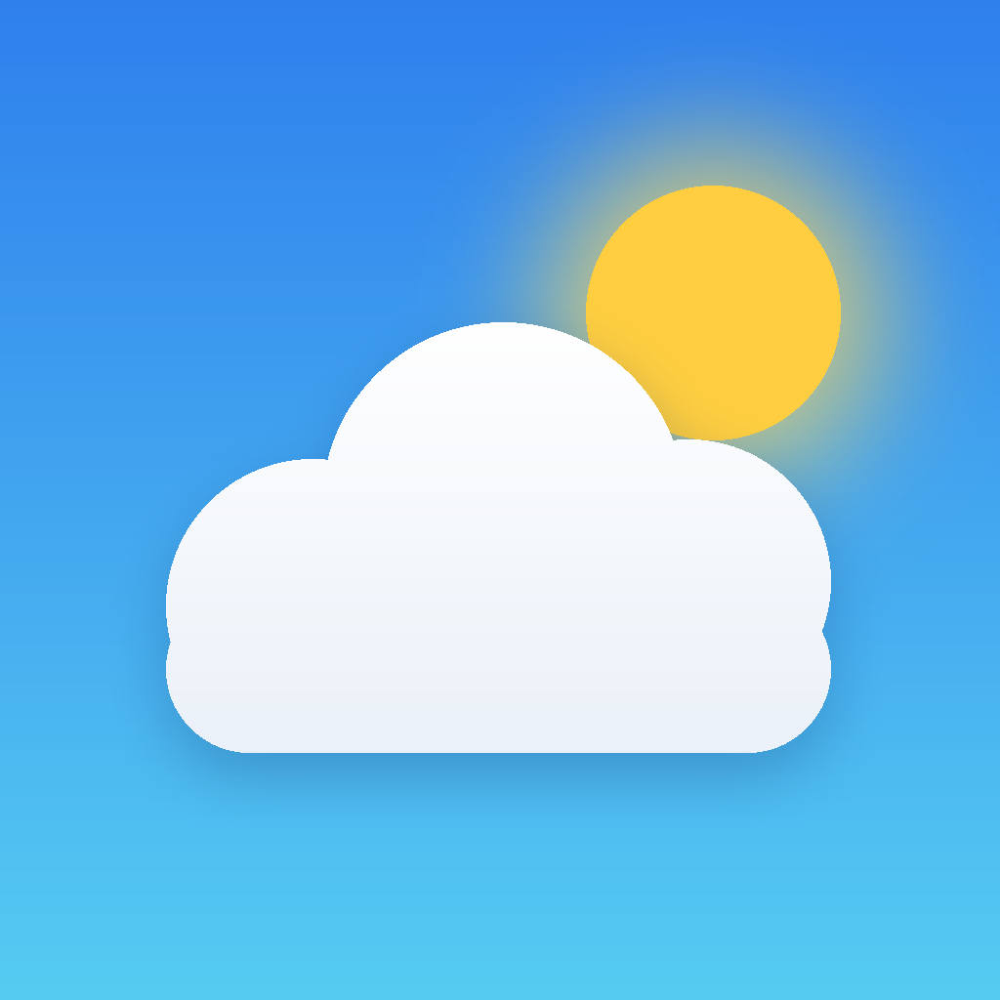
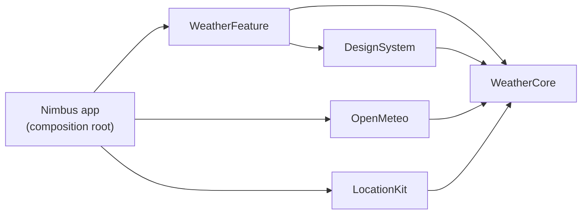

<p align="center">
  
</p>

<h1 align="center">Nimbus</h1>

<p align="center">
  A weather app for iPhone in SwiftUI: your location and saved cities, the next 24 hours, a 10-day forecast,
  and skies that change with the weather. Built on the free Open-Meteo API, with no API key.
</p>

<p align="center">
  
  
  
  
  
  
  
</p>

---

## Features

- **Weather where you are** — Core Location finds you (city-level accuracy is enough and answers faster), and the page is named after your city. If location is off, the page says so and offers a button to Settings.
- **Saved cities** — search any city in the world, swipe between cities like in Apple Weather, delete with a swipe and reorder by dragging. The list survives relaunches.
- **Now** — temperature, condition, today's high and low, over a sky gradient that follows the weather and the time of day.
- **Next 24 hours** — a strip of hours with icons (moons at night) and the chance of rain when it's worth mentioning.
- **10 days** — each day's low-to-high bar is drawn on the same scale as the rest of the week, so a cold day looks cold.
- **Details** — feels like, humidity, wind with its direction, pressure, UV index with its level, sunrise and sunset, all in the city's own time zone.
- **Pull to refresh**, and a quiet refresh when the app comes back after ten minutes or more.
- **Errors that help** — offline, the service not answering, location denied: each has its own message and a way out. A failed refresh never wipes a forecast that is already on screen.
- **Privacy** — coordinates are rounded to two decimals (about 1 km) before they leave the phone.

## Architecture

A local Swift package, `NimbusKit`, holds everything except the app's entry point. Modules only depend inward, on `WeatherCore`:



| Module | What's inside |
|---|---|
| `WeatherCore` | `Place`, `Forecast`, `WeatherCondition` (WMO codes), the service protocols, `WeatherError`, and `ForecastRules`: pure functions for the next hours, the week's temperature scale, compass directions and UV levels. Foundation only. |
| `OpenMeteo` | `OpenMeteoClient` for forecasts and city search. Decodes Open-Meteo's column-shaped JSON and turns it into rows, skipping gaps instead of showing zeros. Network and decoding errors come out as `WeatherError`. |
| `LocationKit` | `DeviceLocationProvider` wraps `CLLocationManager` and `CLGeocoder` in `async` calls. |
| `DesignSystem` | Sky gradients, number and time formats, and reusable views: glass cards, condition icons, temperature bars. |
| `WeatherFeature` | `@Observable` view models (`NimbusModel`, `WeatherViewModel`, `PlaceSearchModel`) and the SwiftUI screens. |

### Key decisions

- **Protocols at the edges.** The screens know `ForecastService`, `PlaceSearchService`, `LocationProvider` and `PlacesStore`, never Open-Meteo or Core Location. Tests use fakes, and another weather provider would be one new type.
- **One page model per city.** Each page loads itself the first time it appears and keeps its own state, so swiping to a city that failed doesn't affect the others.
- **Time zones done right.** Open-Meteo is asked for Unix times plus the city's time zone, so "Today", "15:00" and sunrise are always the city's, not the phone's.
- **Search that waits for you.** Typing restarts a short pause (`.task(id:)` cancels the previous one), so the API is called once you stop typing, not on every key.
- **Testable time.** View models take a clock, so "is this forecast older than ten minutes?" is tested without waiting.

## Requirements

- Xcode 16 or later, iOS 17 or later
- [XcodeGen](https://github.com/yonaskolb/XcodeGen) (`brew install xcodegen`)

No API key is needed.

## Getting started

```bash
git clone https://github.com/Irenapoghosian/nimbus-weather.git
cd nimbus-weather
xcodegen
open Nimbus.xcodeproj
```

Press **⌘R** to run, or **⌘U** to run the tests. In the Simulator, pick a location with **Features → Location**.

## Testing

**63 unit tests**, run on every push by GitHub Actions together with SwiftLint in strict mode. The coverage badge counts logic files; SwiftUI views and the thin Core Location and URLSession wrappers are checked by running the app.

- `OpenMeteoClientTests`, `DecodingTests` — real response shapes as fixtures: mapping, skipped gaps, columns of different lengths, Unix and local times, request URLs, rounded coordinates, offline and server errors.
- `WeatherConditionTests`, `ForecastRulesTests`, `PlaceTests` — WMO codes, day and night symbols, the next 24 hours, the week's scale, compass, UV, saving cities.
- `LocationNamingTests` — naming your location from a city, a region or nothing.
- `NimbusFormatTests` — temperatures (never "-0°"), times in the city's time zone, "Today".
- `WeatherViewModelTests`, `PlaceSearchModelTests`, `NimbusModelTests`, `ForecastDetailsTests` — loading, errors, keeping a forecast after a failed refresh, the ten-minute rule, search, adding, deleting and reordering cities.

## Roadmap

- [x] Forecasts, location, city search, saved cities, tests and CI
- [ ] Animated skies (rain, snow, clouds, stars) and Swift Charts for temperature and rain
- [ ] Home Screen and Lock Screen widgets, and an Apple Watch app
- [ ] Screenshots, a demo video and the first release

## Credits

[Weather data by Open-Meteo.com](https://open-meteo.com/), under [CC BY 4.0](https://creativecommons.org/licenses/by/4.0/). The app shows this credit under every forecast.

## Author

**Irena Poghosyan** — iOS developer · [GitHub](https://github.com/Irenapoghosian)

## License

MIT. See [LICENSE](LICENSE).
