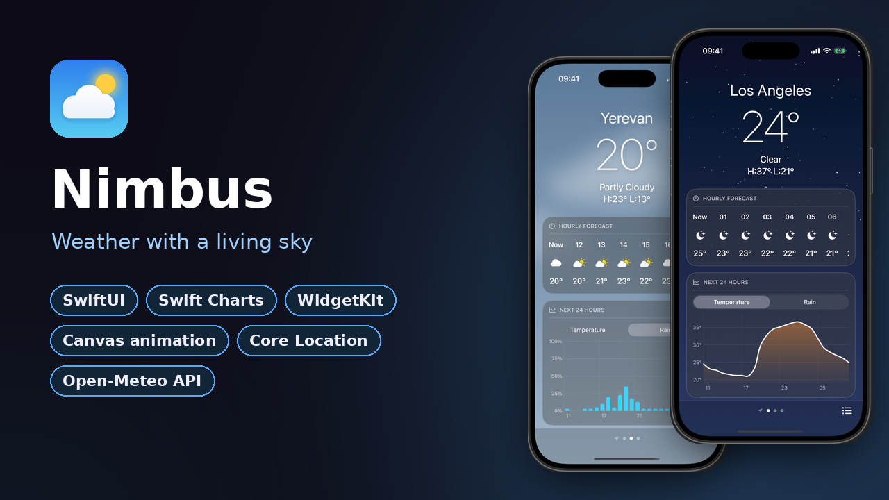

  

  I build native iPhone apps in Swift, SwiftUI and UIKit: camera and on-device AI, live data and charts,
  modular architecture, tested and shipped with CI.

  
  
  

---

## Featured projects

**[Pulse](https://github.com/Irenapoghosian/pulse-crypto)** · Crypto markets & portfolio tracker 
A multi-module app with Clean Architecture: 9 Swift packages, live CoinGecko data with offline cache, interactive Swift Charts, a SwiftData portfolio, Home Screen widgets, VoiceOver and Audio Graphs, and live switching between English, Armenian and Russian. 100+ unit tests, SwiftLint strict and a coverage badge in CI.

 

**[Sight](https://github.com/Irenapoghosian/sight-ai-camera)** · On-device AI camera 
Point the camera and it tells you what it sees, boxes every object (Core ML YOLOv3), reads text, and lifts subjects into PNG stickers. Everything runs on the iPhone at ~12 fps and ~25 ms per frame, with a frame-throttled `async` pipeline that never analyzes a stale frame.

 

**[Lumen](https://github.com/Irenapoghosian/lumen-camera)** · Pro camera with live GPU filters 
A camera built from scratch on AVFoundation, Core Image and Metal: real-time filters, multi-lens zoom (0.5× to 3×), tap to focus, exposure control, and full-resolution capture with the filter applied.

 

**[Echo](https://github.com/Irenapoghosian/echo-chat)** · A UIKit messenger, built in code 
No storyboards: diffable data sources, MVVM with Combine, Core Data persistence, a composer that rides on the keyboard, Reply / Copy / Delete context menus with lifted bubbles, an animated typing indicator, photos with full-screen zoom, and Dark Mode. 34 unit tests in CI.

 

**[Nimbus](https://github.com/Irenapoghosian/nimbus-weather)** · Weather with a living sky 
Your location and saved cities, the next 24 hours as a Swift Charts curve, and a 10-day forecast, over a sky that rains, snows and twinkles (Canvas + TimelineView, with Reduce Motion respected). Home Screen and Lock Screen widgets with their own city search, 7 Swift packages and 89 unit tests in CI.

---

## More projects

<table>
  <tr>
    <td width="50%" valign="top">
      
       <b><a href="https://github.com/Irenapoghosian/expense-tracker">ExpenseTracker</a></b> 
      Expenses and monthly budgets with Core Data, MVVM, onboarding, unit and UI tests in CI.
    </td>
    <td width="50%" valign="top">
      
       <b><a href="https://github.com/Irenapoghosian/feed-app">FeedApp</a></b> 
      An Instagram-style feed on the Unsplash API with infinite scroll and a two-tier image cache.
    </td>
  </tr>
</table>

---

## Tech stack

**Languages & UI** &nbsp;

**Apple frameworks** &nbsp;

**Architecture & tooling** &nbsp;

